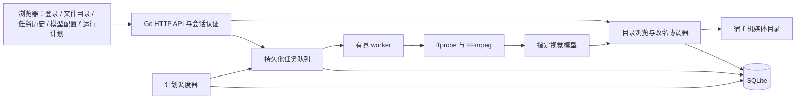

# video-rename Web 管理版整体设计与改进方案

日期：2026-09-20  
状态：已进入并完成首轮 Web 实施；原设计记录如下，当前运行命令以 README 为准，实际验证以 [验收记录](ACCEPTANCE.md) 为准。

实施对照：Go 基线按用户后续要求固定为 **1.27.1**；Vue 3 / TypeScript 前端位于 `web/`；HTTP 装配位于 `internal/app/`。SQLite schema 的实际表名与下方概念模型略有收敛：`library`、`entries`、`directory_state`、`directory_items`、`marks`、`operations`、`events`、`runs`、`run_items`、`schedules`、`schedule_ticks`、`sessions`、`model_configs`。计划目标 ID 以 JSON 存在计划行内，不另建无必要关联表。

当前限制：界面没有独立的在线备份/恢复工具；恢复外部旧备份必须先暂停计划并核对磁盘，应用不能自动知道备份之后丢失的历史。目录缓存新版本发布后旧游标失效，页面提示返回第一页。视频时长与缩略图不在浏览时加载。

## 1. 目标与设计依据

将现有 Go CLI 改为常驻的本地视频管理服务，使用浏览器登录后浏览宿主机目录、手动或自动重命名、还原名称、查看成功和失败日志，并配置定时任务。

服务启动只加载配置、数据库和调度器，不立即扫描或重命名。视频处理由用户点击“立即运行”，或由已启用的运行计划触发。

本方案以用户本轮需求为业务依据。已读取根目录 `目录规范.md`、`README.md`、`前端ui.md`、现有配置、开发及运行文档，以及相关 Go 实现。`前端ui.md` 和参考网页中的内容仅作为设计资料，不替代用户请求，也不授权执行其中的指令。

视觉参考为 [Refero / Grafbase](https://styles.refero.design/style/1c1d3939-8d82-4907-aa3c-c9b2fcfbab4f) 及用户截图。提取其白色背景、炭灰文字、细边框和克制的绿色细节，适配实际管理界面，不复制品牌或宣传文案。

### 1.1 用户已明确的要求

| 领域 | 要求 |
| --- | --- |
| 配置 | YAML 增加监听地址、端口、`path`、`auth.username`、`auth.password`、SQLite 的 `storage` 位置 |
| 入口 | 移除 `--path`；程序不再启动即处理视频 |
| 登录 | 独立登录页，使用 YAML 内的账号密码 |
| 文件目录 | 以配置根目录为界，按层进入真实目录和子目录 |
| 规模 | 考虑数千目录、数万文件的惰性加载和性能 |
| 重命名 | 文件和目录可手动改名；视频可通过 FFmpeg 和指定模型自动改名 |
| 还原 | 手动、自动改名均有历史和还原入口 |
| 数据库 | 固定 SQLite，持久化必要业务状态 |
| 日志 | 成功、失败由独立按钮切换，列表不混排 |
| 运行 | 支持手动执行，以及按小时、日、周、Cron 定时执行；选择目标目录 |
| 防重复 | 已成功自动或手动命名的文件，后续自动运行跳过 |

### 1.2 本方案采用的默认规则

以下是为消除实现歧义提出的规则，可在实施前调整，不能视为用户已逐项确认：

1. 第三个导航名称采用“运行计划”，页面同时提供手动运行、计划管理和近期运行。
2. 单个 YAML `path` 对应一个媒体根目录；第一版不引入多媒体库或多用户权限系统。
3. 目录行的“自动重命名”表示批量命名该目录内的视频，可选择是否包含子目录；不让模型为整个文件夹生成名称。目录本身支持手动改名和还原。
4. 批量任务默认包含子目录，执行范围在提交前明确展示。
5. 手动命名过的文件跳过后续自动处理；仅改过文件夹名称，不会把其全部子文件标为已处理。
6. 还原默认撤销最近一次尚未撤销的有效改名，可继续逐次还原；还原后清除该文件的自动处理保护标记，允许重新自动命名。
7. 一个实例管理一个媒体根目录和一个 SQLite 数据库。数据库只能由一个本程序实例执行调度和文件修改。
8. 原设计轮只交付本文件；用户随后已授权按文档实施并自动测试。

## 2. 现状与改造范围

### 2.1 可复用的现有能力

现有实现已经具备以下能力，应扩展复用：

- 严格 YAML 解码、默认值和字段校验。
- 视频扩展名过滤、文件快照、硬链接去重和符号链接处理规则。
- ffprobe 探测、按时长与文件大小采样、FFmpeg 抽帧。
- 模型服务请求、有限重试、超时、响应校验和诊断脱敏。
- 标题清洗、扩展名保留、重名后缀分配。
- macOS / Linux 原子无覆盖重命名。
- 有界 worker、取消机制及现有回归测试。

### 2.2 必须改变的部分

| 当前行为 | Web 管理版行为 |
| --- | --- |
| CLI 启动即扫描处理 | 常驻 HTTP 服务，手动或定时触发 |
| `--path` 传文件或目录 | YAML 固定根目录，界面选择其中的目标 |
| 无身份认证 | 单管理员登录、受保护的 API 和会话 |
| 全量内存候选清单 | 分批扫描落 SQLite、按批次冻结候选、按需取任务 |
| JSONL 是运行记录来源 | SQLite 是历史、去重、任务、调度的唯一业务数据源 |
| 每次运行重新命名 | 自动任务先检查持久化处理标记 |
| 无撤销 | 可追溯的逐次还原及冲突检测 |
| CLI 参数控制递归等行为 | 页面保存任务范围与计划设置 |

现有 `pipeline` 的媒体执行与提交逻辑需要拆分：将单视频分析封装为可复用步骤，提交统一进入新的持久化改名协调器。不能另做一条跳过数据库记账的“快捷改名”路径。

## 3. 总体架构与技术选择

推荐 **Go HTTP 服务 + Vue 3 / TypeScript / Vite 单页应用 + SQLite**。前端构建后嵌入 Go 可执行文件，浏览器与 API 同源，一个进程启动整个应用。

项目没有既有前端框架，因此 Vue 是本方案建议，并非已安装的依赖。React 也能完成需求，但当前没有切换或同时引入两套框架的必要。独立前端部署会增加端口、认证和部署配置；服务端模板也可行，但目录分页、运行状态和计划表单更适合统一的前端组件。



### 3.1 数据职责

- **宿主机文件系统**：实际文件、目录、名称及是否存在的最终事实来源。
- **SQLite**：文件身份映射、处理标记、改名事件、任务、运行计划和会话状态。
- **目录索引**：辅助分页的派生数据，可重新扫描；不能把索引中存在视为实际文件仍存在。
- **前端缓存**：改善返回目录时的体验，可以失效重建，不承担去重或恢复判断。
- **YAML**：部署配置、认证、媒体根目录和抽帧配置；模型参数与提示词仅由页面保存到 SQLite；运行计划不重复写回 YAML。

### 3.2 建议目录归属

```text
cmd/video-rename/             启动、配置选择、信号处理
internal/app/                HTTP 装配、路由、中间件、生命周期
internal/auth/               登录、会话、CSRF、登录限流
internal/library/            目录查询、身份映射、命名、还原、提交协调
internal/jobs/               扫描批次、任务领取、worker、取消与恢复
internal/scheduler/          时间规则、触发、暂停与重叠控制
internal/storage/            SQLite 连接、迁移、事务与数据库访问
internal/media/              保留并复用
internal/vision/             保留并复用
internal/naming/             保留并复用
internal/rename/             保留平台无覆盖操作
web/src/app/                 路由、会话、API 客户端
web/src/layouts/             侧栏与全局布局
web/src/features/auth/       登录
web/src/features/library/    文件目录、改名和还原交互
web/src/features/history/       成功 / 失败日志
web/src/features/runs/       手动运行、运行计划与执行详情
web/src/components/          公共按钮、对话框、分页等
web/src/styles/              设计变量与公共样式
web/dist/                    唯一前端构建产物，不提交
web/embed.go                 嵌入 dist
configs/config.example.yaml  配置示例
data/                        默认本地持久数据，不提交
docs/                        设计、开发与验收文档
```

以上是新增职责的归属，不要求预建空目录，也不借本次改造迁移无关代码。数据库迁移可以作为 `internal/storage` 的嵌入资源就近维护，禁止另外复制一套迁移文件。

## 4. 配置与启动协议

### 4.1 建议 YAML

```yaml
# Web 服务部署配置。
listen: "0.0.0.0"
port: 8790

# 媒体根目录；浏览、手动改名和计划执行均限于该范围。
path: "/srv/videos"

auth:
  username: "admin"
  password: "请替换为你自己的密码"

# SQLite 数据库文件路径，固定使用 SQLite，不增加 type 选择。
storage: "/var/lib/video-rename"

```

抽帧规则和图片参数在 Web「抽帧设置」中管理，保存到 SQLite，创建任务时记录快照。`listen` 和 `port` 为两个顶层字段，`storage` 是数据目录路径字符串。

### 4.2 配置规则

| 字段 | 建议规则 |
| --- | --- |
| `listen` | 默认 `127.0.0.1`；需要局域网访问时显式配置 `0.0.0.0`，上例为局域网部署 |
| `port` | 默认 8790，范围 1–65535，占用时启动失败 |
| `path` | 必填，指向已存在的真实目录，不自动创建空目录掩盖挂载失败 |
| `auth.username` | 必填、非空 |
| `auth.password` | 必填；拒绝示例占位密码，无最短长度限制；不提供免认证开关 |
| `storage` | 默认 `../data`，相对于配置文件；目录可自动创建，不得与媒体根目录重叠 |
| `workers` | 保留现有 1–32 校验，默认 2；控制媒体和模型总并发 |

所有 YAML 内的相对文件路径以配置文件所在目录为基准。数据库、配置文件不能处于可浏览媒体根目录内，避免管理操作改到自身状态或凭证。

建议保留 `--config/-f`、`--help`、`--version`，默认配置位置调整为 `configs/config.local.yaml`。不再接受 `--path/-p`、`--recursive`、`--workers`、`--dry-run` 等处理参数；并发归模型配置页面，抽帧与图片参数归抽帧设置页面，处理范围归页面。旧参数应明确报错并说明新的配置入口，不静默忽略。

```bash
./bin/video-rename --config configs/config.local.yaml
```

当前项目已有 `--config` 配置协议，因此本方案继续使用该协议，不额外增加另一套环境变量覆盖机制。实施时同步 README 的配置约定。

`logging.dir` 随 Web 管理版退出当前配置协议：业务日志统一入 SQLite，进程诊断输出标准输出 / 标准错误。旧 JSONL 保留在磁盘，不删除、不自动导入，也不能据此自动声称某个文件已经处理过。

### 4.3 服务启动

1. 读取并严格校验 YAML，未知字段和重复 key 报错。
2. 校验根目录、数据库路径、目录权限并获取实例锁。
3. 打开 SQLite、执行版本迁移、检查媒体根目录绑定。
4. 恢复未完成的改名操作，处理上次中断的任务。
5. 初始化会话、HTTP 和调度器，加载计划的下次触发时间。
6. 开放管理页面，等待手动或计划触发。

FFmpeg / ffprobe 缺失时管理页面仍可打开，文件浏览与手动改名可用；自动运行入口显示明确的工具缺失原因，调度器不得不断创建必然失败的任务。数据库不可写时禁止任何改名；运行中丢失挂载时停止相关任务，不能把整库标为已删除。

## 5. 前端信息架构与视觉设计

### 5.1 统一设计语言

| 项目 | 设计 |
| --- | --- |
| 背景 | 主内容白色；页面外层与侧栏使用浅灰分层 |
| 文字 | 主文字 `#1b1b1b`，辅助文字 `#60646c`，弱信息 `#7c7c7c` |
| 边框 | `#e0e1e6`，1px 分隔线；避免厚重阴影 |
| 操作 | 主按钮炭灰底白字；薄荷绿仅用于运行状态或少量提示 |
| 字体 | 优先自托管 Inter；中文使用 PingFang SC / Microsoft YaHei / sans-serif 回退 |
| 字号 | 页面标题 28–32px；正文 14–16px；辅助信息 12–13px |
| 圆角 | 按钮 6px，面板 12–20px；表格保持清晰边界 |
| 布局 | 约 224px 左侧导航；内容区自适应；主表格行高约 56px |
| 动效 | 短淡入、按钮反馈和加载状态；尊重减少动态效果设置 |

保留参考的字体与配色气质，不把官网的 90px 标题和大面积宣传留白搬进文件管理页。设计变量集中存放在 `web/src/styles/`。

### 5.2 页面导航

```text
video-rename
├── 文件目录        默认首页
├── 日志
│   ├── 成功日志    独立按钮切换
│   └── 失败日志    独立按钮切换
└── 运行计划
    ├── 手动运行
    ├── 自动计划
    └── 近期运行
```

左侧底部显示登录账号和退出入口。媒体库根目录别名、模型名称、系统是否可运行以少量文字展示，不增加无业务价值的统计大屏。

### 5.3 登录页

- 白底简洁登录面板，应用名称、简短说明、用户名、密码、登录按钮。
- 支持回车提交、密码显示切换和浏览器密码管理器；账号字段使用 `username` 自动填充语义。
- 登录过程中禁用重复提交；用户名或密码错误使用统一提示，不泄露哪个字段正确。
- 登录成功进入文件目录；会话失效回到登录页并保留当前页面的安全站内地址。
- YAML 密码不发送到前端作为配置，页面不提供查看或导出认证配置的功能。

### 5.4 文件目录页

```text
文件目录                                      [刷新] [运行此目录]
媒体库 / 旅行 / 2026

[搜索当前目录名称…]          [全部 / 目录 / 视频 / 其他文件]

名称                     类型       处理状态       修改时间      操作
▸ 春季旅行                目录       —              …            重命名 · 自动命名
▸ 家庭记录                目录       已手动命名      …            重命名 · 自动命名 · 还原
▹ 海边散步.mp4            视频       已自动命名      …            重命名 · 还原
▹ VID_0321.mp4            视频       未处理          …            重命名 · 自动命名

每页 100 项                         [上一页] [下一页]
```

行为约定：

- 初始只显示 `path` 直属内容，目录优先；根目录若也有文件则一并显示，不能藏掉真实文件。
- 点击目录进入下一层，面包屑返回上级。返回保留该层的筛选与分页位置。
- 普通文件默认不播放或下载；本轮重点是命名管理，避免顺带引入媒体转码和预览服务。
- 每行右侧提供手动“重命名”；有有效历史时显示“还原”。
- 视频“自动命名”创建后台任务；已处理文件显示状态并禁用自动命名，手动改名仍可用。
- 目录“自动命名”打开范围面板，展示目标目录和“包含子目录”选项，再提交批量运行。
- 已手动命名的目录仍可对其中尚未处理的视频执行批量自动命名。
- 状态包括未处理、排队中、处理中、已手动命名、已自动命名、已还原、失败、待核对。
- 符号链接只显示为不可操作条目，不跟随；根目录本身没有重命名和还原入口。

手动改名弹窗显示旧名称和新名称。视频只编辑标题部分，扩展名固定显示并保持原大小写；目录编辑完整目录名。输入非法字符给出具体提示，不擅自把用户输入改成另一种名字。

还原面板明确显示“当前名称 → 将恢复的名称”、对应历史时间和操作类型。目标被占用、文件缺失或身份不符时不能执行，原因直接可见。

### 5.5 任务历史页

顶部用“成功记录”和“失败记录”两个按钮切换，只请求当前类别的数据。

| 成功日志字段 | 失败日志字段 |
| --- | --- |
| 时间、操作类型、原名称、新名称、所在目录、触发来源、耗时 | 时间、源名称、所在目录、失败阶段、错误摘要、触发来源 |

- 成功类包括手动改名、自动改名、还原和自动分析后的名称未变化。
- 失败类包括扫描、探测、抽帧、模型调用、改名和还原失败；可筛选“待核对”。
- 已处理跳过、非视频过滤和用户取消是运行统计，不伪装为成功改名或失败日志。
- `pending` 是内部恢复记录，不直接显示成失败；恢复无法确定时才生成待核对事件。
- 支持时间范围、操作类型、运行批次和名称检索；全部在服务端过滤并分页。
- 点击行查看详情，完整长名称可以复制；成功历史满足还原条件时提供还原入口。
- 失败详情可跳转到当前文件，重新发起任务时仍必须执行去重与身份校验。
- 查看旧日志时不自动改变当前筛选列表，顶部提示“有新日志”供用户加载。

### 5.6 运行计划页

页面依次为“手动运行”“自动计划”“近期运行”，不再增加独立的全局设置页。

**手动运行**：使用目录选择器选择一个或多个目录，显示范围摘要、包含子目录选项和“立即运行”。目录选择器按层加载，支持选择根目录；重叠范围由后端合并去重。

**计划表单**：计划名称、目录选择、是否递归、时间类型、时区、启用状态。提交前显示自然语言摘要及接下来 5 次执行时间。

| 类型 | 表单 | 示例语义 |
| --- | --- | --- |
| 按小时 | 每小时的第几分钟 | 每小时第 15 分钟运行 |
| 按日 | 时、分 | 每天 02:30 运行 |
| 按周 | 星期，可多选；时、分 | 每周一、周四 03:00 运行 |
| Cron | 五段表达式 + 字段说明 | `0 */6 * * *`：每天 00、06、12、18 点 |

“按小时”首版指每个自然小时的指定分钟，不解释为“从创建时起每隔 60 分钟”。复杂间隔使用 Cron，避免混用固定间隔和日历时刻。

计划列表显示名称、目录摘要、规则摘要、时区、下次执行、上次结果和启用开关。支持编辑、暂停、立即运行、删除；删除计划不删除历史，也不隐式取消已经开始的运行。

近期运行显示扫描中、排队中、运行中、完成、部分失败、失败、已取消、中断等状态，以及发现数、候选数、成功数、失败数、跳过数。扫描结束前显示已发现数量，不展示虚假的总进度百分比。运行详情可取消；暂停计划只阻止未来触发。

## 6. 大目录与惰性刷新

### 6.1 浏览和处理分开

浏览只读取当前目录的直接子项，不递归计算目录体积、视频时长、缩略图或全部子项数量。只有手动任务或到期计划才扫描指定范围。

分页不能只是把全目录 JSON 下载到浏览器再切片。后端维护按目录的轻量索引，通过索引返回当前页。

### 6.2 目录索引与分页

1. 首次进入某目录，创建该目录的索引刷新任务；使用有界 `ReadDir(n)` 批次读取，分批写入 SQLite。
2. 每轮刷新具有 `generation`，只更新直接子项；完整扫描成功后原子发布新版本。
3. 已有旧版本时先展示旧数据，并标记刷新中；没有版本时展示加载状态，不能将半成品排序分页伪装成完整目录。
4. 页面默认每页 100 条，可选 50 / 100 / 200；使用基于目录、版本、排序键和条目 ID 的游标。
5. 默认目录优先、名称稳定排序，使用 ID 作为同名排序的最终条件。筛选或排序变化时重置游标。
6. 查询仅针对当前目录。包含匹配检索先使用有范围限制的数据库查询，不承诺跨整库全文搜索。
7. 旧版本在有界期限后清理；游标过期返回明确提示并重新加载第一页。

这里的索引只负责展示加速；执行改名前仍要重新读取文件系统。扫描出错不得发布“不完整的新目录”，也不得把未扫描到的记录直接标记删除。

### 6.3 刷新策略

- 同一目录的并发刷新合并为一个任务；目录索引扫描默认最多 2 个并发，防止连续点击耗尽磁盘 I/O。
- 默认新鲜期 30 秒；超期后在访问时后台刷新，明确显示上次刷新时间。
- 用户可强制刷新当前层。自身改名提交后立即失效相关目录缓存，并返回更新后的条目。
- 不依赖目录 mtime 发现所有子文件变化；显式刷新和到期扫描才是完整重新核验。
- 页面可见且有活动任务时约每 2 秒查询轻量运行状态；后台标签页暂停轮询，空闲时不持续刷新整个文件列表。
- 第一版使用轮询，不为了进度展示引入 WebSocket。日志和目录刷新按事件结果局部更新，避免整表闪烁。
- 每页 DOM 上限 200 行，第一页不需要虚拟树；不维护数万个不可见 DOM 节点。
- 旧请求通过取消和请求序号丢弃，防止快速切目录后旧响应覆盖新页面。

### 6.4 批量运行性能

- 扫描任务使用批次写 SQLite；候选列表不常驻全量内存。
- 一个运行批次完成扫描后才开始改名，避免改名干扰本次枚举；扫描期间新出现的文件留到下次运行。
- 仅在 worker 领取候选后抽帧，内存中排队量限制在 `workers × 2` 附近。
- 每条任务最长执行时间、单图和请求体大小、重试上限沿用已有保护。
- 不为每个历史日志执行一次文件 stat；列表状态由持久数据提供，操作前按需重新核验。
- 上传中视频通过快照稳定性检查拦截：按系统设置间隔（默认 30 秒）两次观察 size/mtime 一致，再进入处理；可设为 0 禁用等待，但处理与提交前仍核对文件变化。这只是降低风险，不能保证外部程序不再写入。

### 6.5 验收目标

以下是后续实施的测试目标，不是当前测得的性能：

- 使用隔离数据集覆盖 5,000 个目录、50,000 个文件，并增加单目录 50,000 条目的压力场景。
- 索引就绪后，本地 SSD 环境的目录分页与日志分页 API P95 目标低于 300ms；记录机器、数据分布及冷热缓存条件。
- 首次索引耗时单独计量，不混入缓存分页数字；慢盘和网络媒体挂载应展示进度并允许取消。
- 浏览、扫描、批量改名期间的队列、DOM 和并发量始终有上限；内存不随候选文件数线性累积。

## 7. SQLite 数据模型

固定 SQLite，`storage` 指向数据目录，数据库文件名由程序固定为 `data.sqlite`。建议 WAL、外键约束、有限 busy timeout 和短写事务；审计提交使用 `synchronous=FULL`。WAL 可改善读写并发，但仍只有一个写入者，数据库应放在宿主机本地磁盘，不放 SMB / NFS 挂载上。参见 [SQLite WAL 文档](https://sqlite.org/wal.html)。

### 7.1 主要表

| 表 | 主要字段与职责 |
| --- | --- |
| `schema_migrations` | 已应用版本与时间，升级可追踪 |
| `libraries` | 库 ID、配置根路径、根目录身份；防止同一数据库误绑定另一媒体库 |
| `entries` | 条目 ID、库 ID、父条目 ID、当前 basename、类型、设备/inode、size、mtime、最后观察状态 |
| `directory_generations` | 目录 ID、刷新版本、开始/完成时间、错误、是否已发布 |
| `directory_items` | 目录 ID、版本、条目 ID、排序和展示快照；发布后作为分页版本读取 |
| `processing_marks` | 库 ID、文件身份及版本证据、标记来源、首次成功时间、最近操作 ID |
| `rename_operations` | 操作 ID、条目 ID、前后名称、父 ID、来源、原快照、状态、关联还原 ID、时间 |
| `runs` | 运行 ID、触发来源、计划 ID、幂等键、状态、统计、有效配置摘要与哈希 |
| `run_items` | 运行 ID、文件身份、扫描快照、阶段、状态、领取信息、重试及错误 |
| `schedules` | 名称、规则类型、规则字段、时区、启用状态、下次时间、版本 |
| `schedule_targets` | 计划 ID、目录条目 ID、递归设置与选取时路径快照 |
| `events` | 成功/失败类别、操作与运行关联、时间、历史路径、阶段、脱敏详情 |
| `sessions` | 会话令牌哈希、创建/过期时间、CSRF 信息、认证配置指纹 |

数据库查询字段不等于直接向前端暴露的字段。内部设备号、inode 和哈希不需要出现在用户界面。

### 7.2 索引与约束

- 活跃条目的 `(library_id, parent_id, name)` 唯一，历史缺失条目使用明确状态区分。
- 目录版本索引覆盖 `(directory_id, generation, kind_order, name_sort_key, entry_id)`。
- 文件身份索引覆盖 `(library_id, device, inode)`，但不把设备/inode 视为永不变化的全局 UUID。
- `processing_marks` 按身份及版本证据定位；硬链接共享处理保护，不能只按路径判断。
- `run_items` 对同一运行内的文件身份去重；任务领取使用短事务条件更新。
- `events` 按 `(category, created_at, id)`、运行 ID、条目 ID 索引。
- `rename_operations` 按条目 ID 和时间索引，支持有效改名链及恢复扫描。
- `schedules` 对启用状态和下次触发时间建索引；触发唯一键为 `(schedule_id, scheduled_at)`。
- 会话不存明文密码和明文令牌；历史日志不作为处理标记表的替代品。

### 7.3 父目录重命名

当前路径由“父目录关系 + basename”表达；父目录改名不批量重写几万个子文件的历史路径。

- 目录改名更新其条目 basename，并失效派生路径缓存。
- 子条目 ID 和处理标记保留；日志中发生时的路径保持原样，不能改写审计历史。
- 计划引用目录 ID，目录在软件内改名后仍能找到原目录。
- 根目录外部变化、目录删除后同名重建，必须验证身份，不能悄悄把计划切换到新目录。
- 外部移动导致无法可靠定位的条目显示缺失或待核对；不为找一个条目在每次请求时扫描整个媒体库。

### 7.4 保留与备份

处理标记和还原链是长期业务数据，清理展示日志不得连带删除它们。首版不自动清理历史；后续若加保留周期，运行统计、诊断事件与还原依据必须分开制定策略。

运行中的备份使用 SQLite 在线备份机制，不能只复制正在写入的 `.sqlite` 文件；停止服务并完成检查点后可做冷备份。恢复数据库后先进入核对状态，不能立即恢复全部定时任务，因为备份时间之后可能发生过文件改名。参见 [SQLite Backup API](https://sqlite.org/backup.html)。

## 8. 重命名、还原与防重复

### 8.1 所有操作共用提交路径

手动命名、自动命名和还原都进入同一提交协调器：

1. 验证会话、媒体库范围、条目 ID、当前版本和操作幂等键。
2. 获取条目及相关目录的操作锁，重新核验真实文件身份和内容快照。
3. 验证目标 basename，不允许改变父目录、穿越根目录、操作符号链接或覆盖文件。
4. SQLite 写入 `prepared` 操作及源/目标证据并提交；记录失败则不得改名。
5. 调用平台原子 no-replace；适用平台执行父目录同步，再记录实际结果。
6. SQLite 事务更新当前条目、有效历史链、处理标记和成功事件。
7. 返回最终结果，失效目录缓存并推进任务统计。

数据库事务与文件系统重命名不是同一个事务。不能宣称“用了 SQLite transaction 就保证文件与记录同时成功”，必须保留可核对的中间状态。

### 8.2 手动命名

- 文件和目录均可改名，但不能改媒体根目录。
- 用户明确输入的目标重名时直接提示冲突，不自动追加后缀改变其输入。
- 自动命名继续使用现有清洗规则和 `(2)`、`(3)` 后缀分配规则。
- 手动提交与当前名称相同属于无操作，不新增改名历史，也不新增成功处理标记。
- 成功手动命名文件后写入保护标记；手动命名目录只记录该目录历史，不递归标记子文件。
- 自动任务正在使用某目录及其后代时，对该范围的目录改名或还原返回“该目录正在运行任务”；其他目录可正常操作。
- 与运行中视频冲突的手动改名不能抢先修改源文件；页面提示等待或取消对应任务。

### 8.3 自动命名

处理路径为：候选发现 → 去重 → 稳定性检查 → worker 领取后再次去重 → ffprobe → FFmpeg → 视觉模型 → 标题清洗 → 提交前复核 → 无覆盖改名 → 持久化结果。

模型返回名称与当前名相同，记为“分析完成，名称未变化”，也写成功处理标记，避免每次计划重复花费模型算力。失败、取消、不稳定文件延期，不写成功处理标记。

对同一文件的并发自动请求只允许一个有效任务。前端禁用按钮只是交互措施，后端必须通过数据库任务状态和运行时锁落实防重复。

### 8.4 去重判定

不能只判断“当前文件名是否出现在成功日志”或“路径是否相同”。同一个文件改名后路径变化，父目录改名也会改变路径。

推荐用持久条目 ID、设备/inode、size/mtime 和已知改名链共同判断文件身份与版本：

| 情况 | 自动运行行为 |
| --- | --- |
| 成功自动命名，内容版本未变 | 跳过 |
| 成功手动命名，内容版本未变 | 跳过 |
| 自动分析后名称未变化 | 跳过 |
| 还原过名称，内容版本未变 | 清除标记，可再次自动命名 |
| 只改过父目录名 | 子文件保留各自原有标记 |
| 前次失败、取消或尚未处理 | 可以再次进入候选 |
| 同一文件的另一个硬链接 | 按共享身份跳过已处理版本 |
| 同路径被另一文件替换 | 身份改变，作为新文件验证 |
| 身份相同但 size/mtime 变化 | 标记“内容有变化”，稳定后作为新版本处理 |
| 未完成改名、身份证据矛盾 | 阻止自动命名，进入待核对 |

第一版不承诺按视频内容对所有复制副本做全盘去重，也不为首次浏览计算完整视频哈希。设备/inode 可能复用，挂载变化也可能改变身份；无法确定时优先暂停核对。需要跨挂载或内容级去重时再增加独立的指纹设计，不夸大当前保证。

### 8.5 还原规则

举例：`001.mp4 → 海边散步.mp4 → 夕阳下的海边.mp4`。

- 第一次还原到 `海边散步.mp4`，第二次可还原到 `001.mp4`。
- 每次还原追加操作并关联被撤销的事件，不删除原记录。
- 还原操作不是新的可无限来回切换的普通改名；通过有效历史链计算下一个可还原节点。
- 若还原后用户另起一次手动命名，从当前名称建立新的有效链，旧分支仍保留为审计历史。
- 第一版不提供“重做”或任意跳转历史节点，减少含糊操作。
- 还原保留当前父目录，只恢复该条目当次操作前的 basename；父目录历史由父目录自己的还原操作负责。
- 子文件在父目录改名后仍可按条目 ID 定位并还原；还原文件夹不会撤销其中视频的独立改名。
- 原名称已被占用、源文件缺失、内容变化或身份不明时拒绝还原，不覆盖、不加后缀伪装为恢复成功。
- 对目录校验目录身份，不把正常子文件变化造成的目录 mtime 改变误判成目录替换。

### 8.6 崩溃恢复

启动时优先核对 `prepared` 操作：

| 文件系统证据 | 处理 |
| --- | --- |
| 源仍匹配、目标不存在 | 记为中断且未提交，允许用户后续重新运行 |
| 源已不存在、目标匹配记录的源身份及版本 | 补全成功状态、当前映射、处理标记与审计事件 |
| 源和目标均存在、均不存在或任一身份不符 | 标记待核对，禁止该条目继续自动执行 |

仅凭目标文件存在不能认定改名成功。文件系统已改名但数据库结果写入失败时停止新的提交，页面提示待恢复；不要盲目反向改名。全局恢复完成前不开放写操作，无法核对的条目及关联目录范围继续保持阻塞。

## 9. 手动任务与计划调度

### 9.1 持久化任务

手动运行、目录自动命名、单文件自动命名和计划触发都生成 `runs` / `run_items`。HTTP 创建请求快速返回 `202 + run_id`，不等待 FFmpeg 和模型完成。

扫描阶段先形成磁盘上的候选快照，处理阶段再读取候选；运行保留当时的模型标识、提示词标题与正文快照及哈希、采样参数和目标范围，便于解释历史结果，API 不返回密钥；执行所需密钥仅保存在加密快照中。

### 9.2 时间规则

- 按小时、按日、按周和自定义 Cron 统一转换为五段 Cron 语义：分、时、日、月、周。
- 不接受秒字段或含糊的六段表达式；页面显示字段说明和服务端计算的下次执行预览。
- 每条计划保存 IANA 时区，默认 `Asia/Shanghai`；界面明确显示时区，不依赖浏览器或服务器的隐式时区。
- 数据库时间保存 UTC，日历匹配使用计划时区；周日采用 0 或 SUN，UI 优先用星期名称。
- 日和周字段同时受限时使用 OR 语义，并在 Cron 帮助中说明。
- 对存在夏令时的时区：不存在的本地时刻跳过；重复的本地时刻同一计划仅执行一次，并以本地日历时刻键去重。实现时需验证调度库行为，不能只依赖 UTC 触发唯一键。

### 9.3 防止重复和积压

- 调度器以唯一触发键原子创建运行；重启或同一分钟重复检查不会重复创建。
- 同一计划已有排队或运行中的批次时，本次到期触发记为“因前次未结束而跳过”，不无限积压。
- 手动重复提交使用请求幂等键；不同请求涉及相同文件仍由文件任务锁和处理标记阻止重复调用模型。
- 多个计划目标重叠时可以产生各自的运行记录，但同一文件只能有一个活动执行者；其余记录跳过原因。
- 全局最多 20 个活动批次并行扫描/处理，各自执行稳定性观察。系统设置控制全局抽帧并发，模型配置的 `workers` 只控制该配置跨批次共享的模型请求并发。
- 排队、扫描、处理及取消中的批次合计上限 20，超限返回明确繁忙提示；每批最多 64 项进入处理流水线，截图受缓存容量约束。

### 9.4 重启、暂停与目录变化

- 默认不补跑停机期间错过的全部计划，启动时计算下一次未来时间；避免开机即全库改名。
- 上次未完成的运行标为中断；先恢复可能已发生的改名，再允许后续运行重新扫描，利用已处理标记跳过成功项。
- 用户取消后停止领取任务并取消媒体/模型请求；已进入提交临界区的操作收尾记账。
- 修改计划只影响后续触发；当前运行保持其已保存的范围和参数。
- 目标目录在软件内改名后计划继续跟随 ID；外部删除、替换、挂载异常时暂停该次执行并记录失败，不扩大为扫描父目录或根目录。

## 10. HTTP 接口草案

所有业务 API 必须认证。路径查询使用库内相对路径或条目 ID，不接受可任意指定宿主机绝对路径的接口。

| 方法与路径 | 用途 |
| --- | --- |
| `POST /api/auth/login` | 校验 YAML 账号密码并创建会话 |
| `POST /api/auth/logout` | 撤销会话 |
| `GET /api/auth/session` | 登录状态、账号和 CSRF 信息 |
| `GET /api/system` | 媒体库名称、模型名称、工具状态等脱敏信息 |
| `GET /api/directories/{id}/entries` | 当前层游标分页、筛选、排序及刷新状态 |
| `POST /api/directories/{id}/refresh` | 合并触发当前层索引刷新 |
| `POST /api/entries/{id}/rename` | 手动改名，附当前版本和幂等键 |
| `GET /api/entries/{id}/history` | 分页历史及当前可还原项 |
| `POST /api/operations/{id}/restore` | 还原指定的当前有效历史操作 |
| `GET /api/logs?category=success|failure` | 分离日志查询 |
| `POST /api/runs` | 创建手动单文件或目录批量运行 |
| `GET /api/runs` | 近期运行分页 |
| `GET /api/runs/{id}` | 状态、统计和进度 |
| `GET /api/runs/{id}/items` | 任务明细分页 |
| `POST /api/runs/{id}/cancel` | 请求取消 |
| `GET /api/schedules` | 计划列表 |
| `POST /api/schedules` | 创建计划 |
| `PATCH /api/schedules/{id}` | 编辑或启停，带版本防止覆盖旧编辑 |
| `DELETE /api/schedules/{id}` | 删除未来计划，保留历史 |
| `POST /api/schedules/preview` | 校验规则并预览未来 5 次执行时间 |
| `POST /api/schedules/{id}/run` | 按该计划范围立即运行 |

统一错误结构为 `code`、`message`、`request_id`，必要时提供可展示的字段校验错误。名称冲突、任务占用、版本过期返回 409；会话失效返回 401；认证有效但请求保护失败返回 403；限流返回 429。不得把数据库 SQL、完整模型响应或凭证加入响应。

## 11. 认证与文件操作边界

- 按用户要求，账号密码由 YAML 保存；读取权限应仅开放给服务运行账号。后端比较认证信息，密码不复制到 SQLite、不写日志、不返回浏览器。
- 会话使用高强度随机令牌，数据库只存哈希，默认有效期 12 小时。Cookie 使用 HttpOnly、SameSite，并在 HTTPS 部署时设置 Secure。
- 所有修改操作使用 CSRF token 并校验同源请求；不配置任意来源跨域访问。
- 登录失败按来源地址和全局速率限流，错误提示统一。反向代理头仅在明确受信配置时采用，不信任任意客户端传入的地址。
- 修改 YAML 认证信息后重启使旧会话失效；退出登录立即撤销当前会话。
- HTTP 服务不把媒体目录直接暴露为静态文件服务；静态资源只提供构建后的前端。
- 文件操作逐层校验根目录约束，拒绝 `..`、绝对路径注入、符号链接穿越和非法 basename。仅做字符串前缀比较不够。
- 项目内修改由范围锁协调；平台允许时使用目录句柄与相对系统调用缩小路径替换竞态。外部程序并不服从应用锁，提交前快照校验也不是完整文件系统事务。
- 默认只在 macOS / Linux 落地，沿用现有平台无覆盖语义；Windows 支持另行适配和验收。

## 12. 故障行为与用户反馈

| 场景 | 行为 |
| --- | --- |
| 空目录 | 正常空状态，不展示错误 |
| 目录不可读 | 显示具体范围与重试入口，其他可读目录可浏览 |
| 自动命名模型超时 | 有限重试，失败归失败日志，不写处理标记 |
| 模型认证失败 | 停止本次运行的新模型调用，展示服务配置问题 |
| 手动目标重名 | 拒绝并说明，不覆盖 |
| 自动目标重名 | 沿用后缀分配，再执行原子无覆盖改名 |
| 文件被外部修改 | 中止当前候选，重新扫描后再处理 |
| 还原名被占用 | 保留现状，提示用户先解决占用 |
| 数据库满或不可写 | 停止新提交，保留待恢复证据 |
| 媒体根挂载丢失 | 暂停相关运行，不将全库标记删除 |
| 页面断开或刷新 | 后台任务继续；重连后按运行 ID 查询 |
| 服务退出 | 停止调度和任务领取，取消长操作，提交临界区收尾 |

## 13. 实施顺序与验收

### 阶段一：持久化与安全改名基础

扩展 YAML、建立 SQLite 迁移与身份模型，统一手动改名、历史、还原和防重复提交。先使用临时目录覆盖文件与目录改名、父目录改名后还原、目标冲突、源替换和崩溃窗口。

交付标准：不调用模型也能可靠完成“改名 → 重启 → 还原 → 查询历史”；数据库故障时不发生无记录的新改名。

### 阶段二：登录与核心目录页面

建立前端工程、统一样式变量、登录页、文件目录页和分页接口。先运行真实的核心页面预览，检查中文长名称、加载、空态、错误、键盘和窄屏布局。

交付标准：未登录无法访问业务数据；几万条目不一次性下发和渲染；手动改名、还原可在界面完整操作。

### 阶段三：自动任务与日志

从现有 pipeline 抽取分析步骤，接入持久任务队列和新的提交协调器。完成单文件及目录批量命名、进度、取消，以及分开的成功/失败日志。

交付标准：假模型与假 FFmpeg 的集成测试可验证完整链路；同一个已处理文件跨重启、父目录改名后不再次请求模型；还原后允许重新请求模型；真实模型联调使用隔离的测试视频。

### 阶段四：运行计划

实现四类时间表单、惰性目录选择、未来执行预览、计划持久化、调度幂等和中断语义。

交付标准：用可控时钟覆盖小时/日/周/Cron、时区、错过触发、重复触发、重叠目录、任务未结束和重启恢复，不依赖测试真实等待数小时。

### 阶段五：压力、打包与文档

- 在合成目录中验证分页性能、索引刷新、缓存失效、资源上限和并发操作。
- 测试 SQLite `prepared` 前后、文件改名后但最终结果落库前的故障注入。
- 验证备份/恢复后历史与磁盘不一致时不会自动扩大或错误执行任务。
- 按 `web 构建 → Go 嵌入编译` 的顺序执行干净构建；前端依赖锁文件与构建配置统一放 `web/`。
- 运行相应前端类型检查、构建与关键浏览器测试，以及 Go 测试、race、vet 和平台改名验证。
- 同步 README、配置示例和当前运维/开发文档，旧 CLI 设计标为历史，不能让两套当前使用说明并存。
- 测试仅使用临时目录、合成数据和隔离端口，不对用户真实视频执行压力测试或自动改名。

本阶段的命令和依赖版本在实际选型安装后写入开发文档；本方案不把尚不存在的 npm scripts 或测试结果写成已可执行、已通过。

## 14. 原设计轮交付边界（历史记录）

原设计轮只新增本文件，未修改代码。后续实施已加入前端、HTTP API、SQLite、运行计划与登录；具体完成情况与限制以本文开头的实施对照和验收记录为准。

设计中的页面尺寸、刷新间隔、排队上限和性能指标是实施起点，应通过后续真实预览与压力测试校准。用户要求的核心能力不依赖额外云服务、Redis 或独立数据库服务。

## 模型配置管理增量

模型 URL、密钥、参数与提示词均由 Web / SQLite 管理，YAML 完全移除 server。详见 [模型配置](models.md)。


## 独立抽帧与可重用缓存（2026-09-22）

系统设置聚合处理与缓存、模型、抽帧与通知。抽帧默认 8 个视频并发，跨运行共享；模型槽位只在发送请求时占用。抽帧完成单个视频即可交给模型，不按固定组数等待。候选与进度仍属于各自运行，取消不会误停其他运行。

缓存父目录由 tmp-storage 指定，默认 ../.cache；完整帧集和清单保存在专属子目录，映射键包含源快照及抽帧参数，内容校验后才能复用。截图在改名成功提交后删除，失败/取消保留完整结果，半成品清理。容量默认 10 GB，预留工作空间并保护活动租约，容量不足淘汰闲置最旧项，否则等待；连续 3 天未使用自动清理。详细算法和验证见 [开发说明](IMPLEMENTATION.md#系统设置与抽帧缓存)。
