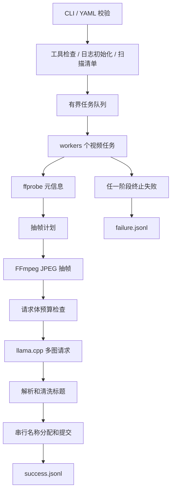

# video-rename 总体设计

## 1. 需求与边界

用户输入一个文件或目录，程序自行完成视频发现、元信息探测、抽帧、视觉理解和文件重命名。覆盖几 MB 到几 GB、约 500p 到 4K 的本地视频。模型服务由用户自己部署，程序连接现有 llama.cpp，不负责下载模型或启动服务。

首版具备：YAML 配置、可替换业务 prompt、有界并发、分离的成功/失败日志、超时与有限重试、名称清洗、冲突处理和 dry-run。目录默认不递归，显式 `--recursive` 才处理子目录。

首版不做：Web UI、数据库、定时监控、云上传、转码原视频、音频识别、全视频语义分析、自动分类搬家、字幕文件联动改名、自动恢复历史任务。原视频编码内容保持不变。

标题基于抽取的视觉片段，不能保证描述所有情节、对白或声音；需要音频语义的命名属于后续能力。

## 2. 方案比较

| 方案 | 优点 | 代价 | 结论 |
| --- | --- | --- | --- |
| 只按文件大小分档抽帧 | 直观、容易配置 | 受码率影响，低码率长视频可能抽得太少 | 可选 size 策略 |
| 时长为主、大小辅助、均匀采样 | 可预测，适应大小与分辨率差异 | 无法保证捕获短暂事件 | 默认 hybrid，分档可配置 |
| 场景检测后选代表帧 | 适合剪辑丰富的视频 | 常需扫描更多画面，耗时难约束，静态长视频仍需兜底 | 后续版本评估 |

每个视频的所有抽帧放进一次请求，模型可以同时比较画面。暂不逐帧发请求后再二次总结，避免请求数膨胀和摘要信息损失。暂不拼接联系表，避免默认缩小每幅画面的有效细节。

## 3. CLI 契约

```bash
./video-rename --config config.yaml --path /videos/example.mp4
./video-rename -f config.yaml -p /videos
./video-rename -f config.yaml -p /videos --recursive --workers 2
./video-rename -f config.yaml -p /videos --dry-run
```

| 参数 | 默认 | 语义 |
| --- | --- | --- |
| `--config, -f` | `./config.yaml` | 配置文件，不存在即启动失败 |
| `--path, -p` | 必填 | 单一本地文件或目录，不接受 URL 或多个位置参数 |
| `--workers, -w` | YAML 中的值 | 覆盖并发数量 |
| `--recursive, -r` | false | 递归目录；`--recursive=false` 可显式关闭 |
| `--dry-run` | false | 生成拟用名称和预览日志，不改视频名 |
| `--help, -h` | — | 显示帮助，不要求配置和外部程序可用 |
| `--version` | — | 显示构建版本，不要求配置和外部程序可用 |

同一选项通过不同别名重复提供时视为参数错误，避免隐藏优先级。未知参数报错。相对 `--path`、`--config` 以当前工作目录解释；logging.dir 的相对路径以配置文件所在目录解析，默认 ./logs；工具从 PATH 查找，不提供工具配置。

配置顺序：内置默认值 → YAML → 显式 CLI 参数。只有 workers 同时提供 YAML 和 CLI 设置；递归和预览仅由 CLI 控制。不做环境变量或模板展开。

## 4. 架构



采用 Go 标准库 `net/http`、`encoding/json`、`os/exec`、`context`、`log/slog`，YAML 库选择支持严格字段校验的维护版本；CLI 可选 pflag 以稳定支持双横线与短参数。依赖版本在实际实施时锁定到 go.mod/go.sum。本次不创建这些文件。

不引入 Python 运行依赖，不把 FFmpeg 绑定成 C 库，不需要 CGO 访问媒体编解码器。平台专用无覆盖 rename 封装可以使用受支持的系统调用库。

### 建议目录（未来实施）

```text
cmd/video-rename/main.go             CLI 入口、退出码
internal/config/                    默认值、加载、严格校验
internal/discovery/                 文件发现、快照、去重
internal/media/                     ffprobe、采样、FFmpeg
internal/vision/                    HTTP 请求、响应、重试
internal/naming/                    标题清洗、长度、冲突分配
internal/rename/                    平台无覆盖提交与文件身份检查
internal/pipeline/                  worker 调度、取消、状态汇总
internal/runlog/                    两路 JSONL、持久化和失败传播
internal/domain/                    共享任务数据和错误码
docs/                              设计和运维文档
testdata/                          小型合法测试夹具
config.example.yaml                实施阶段创建的配置样例
```

模块只交换明确的数据：`VideoJob`（源路径与身份快照）、`VideoMeta`（流索引、时长、字节数、显示尺寸）、`FramePlan`、`FrameSet`、`TitleResult`、`RenamePlan`、`JobResult`。媒体模块不访问 HTTP，模型模块不改文件，命名模块不执行 rename。

视频任务状态：`queued → probing → extracting → inferencing → naming → committing → renamed`。预览在 `naming` 后成为 `previewed`；名称无变化成为 `unchanged`；任一阶段可到 `failed` 或 `cancelled`。每个已纳入清单的任务恰好有一个最终结果；提交前的审计事件不属于最终结果。

## 5. 默认行为与待实测项

默认使用中文简短标题、`workers=2`、`temperature=0.2`、文本输出、最多 12 张最长边 768 像素的 JPEG。用户可通过配置改变标题语言与风格。程序没有固定的视频题材分类逻辑。

已选定的默认值不需要阻塞文档交付。实现前联调需要确认真实的 base_url、model、多图能力和机器容量；这些都是部署参数，不在源码中硬编码。

质量验收分两层：自动检查系统行为和文件安全；人工评价真实视频标题是否准确。通过功能测试不等于标题质量已经达标。
